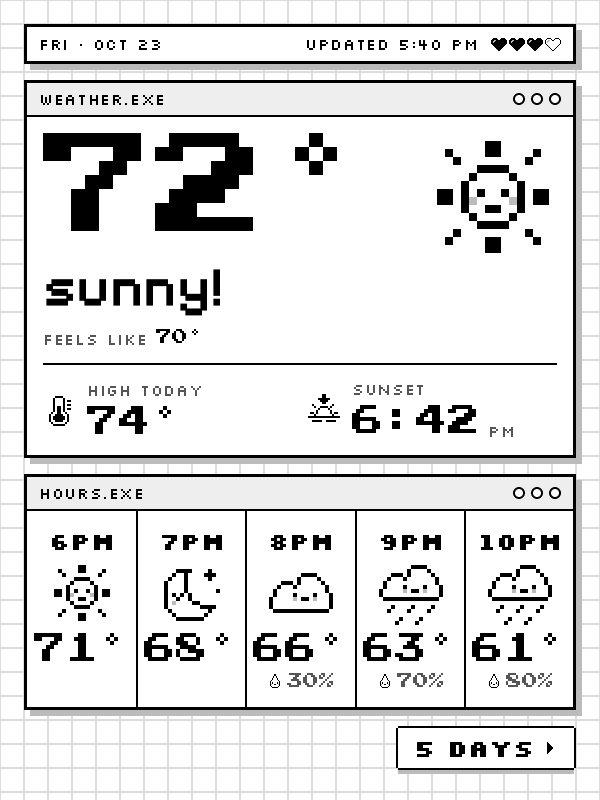
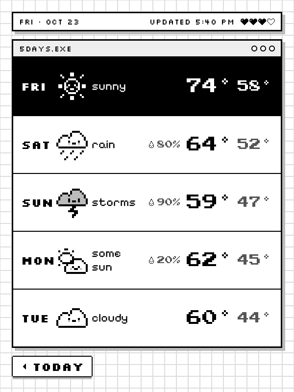

# Kindle Weather App

An always-on weather display for a jailbroken Kindle, drawn in a pixel style: square
pixel windows on graph paper, pixel weather icons with little faces, and chunky arcade
numbers you can read from across the room.

<p>
  
  
</p>

- **Main screen:** the temperature now, the condition, feels-like, today's high, the
  next sunrise or sunset, and the next five hours.
- **Days screen:** tap **5 DAYS ▶** for the five-day forecast and **◀ TODAY** to go
  back. Updates refresh whichever screen is showing.
- Updates every 15 minutes over the Kindle's Wi-Fi, with a full e-ink refresh each time.
  No account or API key: forecasts come from [Open-Meteo](https://open-meteo.com/).
- **Hold the top status bar for 3 seconds** to exit back to the normal Kindle UI.

It runs entirely on the Kindle as one small static program, so no computer or server
needs to stay on.

## Requirements

- A **jailbroken** Kindle with root shell access, for example SSH over USB with
  [USBNetLite](https://github.com/notmarek/kindle-usbnetlite), or
  [KUAL](https://www.mobileread.com/forums/showthread.php?t=203326) to launch it.
- Wi-Fi on the Kindle.
- To build: [Go](https://go.dev/) 1.26 or newer on your computer.

Tested on a **Kindle 10th generation (2019), firmware 5.16.7**: a 600 × 800 screen with
the touchscreen at `/dev/input/event2`. Kindles with larger screens (Paperwhite, Oasis,
Scribe) are not supported yet; the layout is fixed at 600 × 800.

## Install

1. Build the Kindle program:

   ```bash
   cd src && GOOS=linux GOARCH=arm GOARM=7 CGO_ENABLED=0 go build -trimpath -ldflags "-s -w" -o ../kindle/extensions/kindle-weather/bin/kindle-weather .
   ```

2. Make your settings: copy `kindle/extensions/kindle-weather/kindle-weather.example.json` to
   `kindle-weather.json` in the same folder and set your place's `name`, `latitude`,
   `longitude` and `timezone` (an IANA name such as `America/Chicago`, or `auto`).

3. Copy the extension folder to the Kindle, for example over SSH (`kindle` being your
   SSH host for the Kindle):

   ```bash
   scp -r kindle/extensions/kindle-weather kindle:/mnt/us/extensions/
   ```

   In USB storage mode, copy `kindle/extensions/kindle-weather` to the `extensions` folder
   on the Kindle drive instead.

4. Start it from KUAL (**Kindle Weather → Start weather display**) or over SSH:

   ```bash
   ssh kindle /mnt/us/extensions/kindle-weather/bin/start.sh
   ```

   Stop it with a 3-second hold on the status bar, from KUAL, or with `bin/stop.sh`.
   It does not start by itself after the Kindle reboots.

## Settings

`kindle-weather.json` on the Kindle:

| key | default | what |
| --- | --- | --- |
| `name` | | label for the log |
| `latitude`, `longitude` | | the place to forecast |
| `timezone` | `auto` | IANA time zone for times and dates |
| `units` | `imperial` | `imperial` (°F, mph) or `metric` (°C, km/h) |
| `refresh_minutes` | `15` | how often to update (5 or more) |
| `theme` | `paper` | `paper`, or `night` for the whole screen inverted |
| `touch_device` | `/dev/input/event2` | the touchscreen's input device |
| `touch_swap_xy`, `touch_flip_x`, `touch_flip_y` | `false` | if taps land in the wrong place |

Restart the display after changing them. `bin/kindle-weather touchprobe -config kindle-weather.json`
prints where taps land, which helps when calibrating a different model.

## How it works

`bin/start.sh` runs `bin/run.sh` in the background. It keeps the screen saver off, pauses
the stock Kindle UI (`stop lab126_gui`) and runs `bin/kindle-weather`, a static Go program
that:

- fetches the forecast with the Kindle's own `curl`,
- draws the 600 × 800 screen into an 8-bit grayscale PNG, snapped to the panel's 16 gray
  levels,
- shows it with `eips` (full refresh),
- reads taps straight from the touchscreen.

When the program exits, `run.sh` turns the screen saver back on and restarts the Kindle
UI (`start lab126_gui`), which takes about a minute and a half. A goodbye screen stays up
in the meantime. Nothing outside `/mnt/us/extensions/kindle-weather` is changed.

With the Kindle UI paused, nothing else rejoins Wi-Fi after the network drops (a router
restart, say), so before each update the program checks the connection and, if it is
down, turns the Kindle's wireless off and on to reconnect. Updates run in the background,
so taps always respond. If there has been no forecast for 3 hours, the screen says so
instead of showing old weather as current.

While running, it writes `kindle-weather.log`, `cache.json` (the last forecast, shown if
Wi-Fi is down at start) and `screen.png` (the screen being shown) to its folder.

## Development

| path | what |
| --- | --- |
| `src/render.go` | the screens: a port of the design's CSS layout |
| `src/icons.go` | the 16 × 16 pixel icons |
| `src/weather.go` | Open-Meteo request, weather codes → icons and words |
| `src/main.go`, `src/touch_linux.go` | the display loop and touch input |
| `design/` | the design system the screens are built from: tokens, components and previews |
| `reference/` | the design's WeatherScreen and DaysScreen rendered in Chrome |

```bash
scripts/check.sh
```

renders the design's sample data and compares it with the Chrome references (currently
within a pixel). Render other screens on your computer with
`build/kindle-weather-mac render -sample -screen days -o days.png` (`main`, `days`,
`offline`, `bye`; `-night` for the Night theme; `-data forecast.json` for a saved
Open-Meteo response).

## Credits

- Weather data by [Open-Meteo.com](https://open-meteo.com/) (CC BY 4.0).
- Fonts, all under the SIL Open Font License (`src/fonts/OFL-*.txt`):
  [Press Start 2P](https://fonts.google.com/specimen/Press+Start+2P) for numbers,
  [Pixelify Sans](https://fonts.google.com/specimen/Pixelify+Sans) for words, and
  [Silkscreen](https://fonts.google.com/specimen/Silkscreen) for labels.
